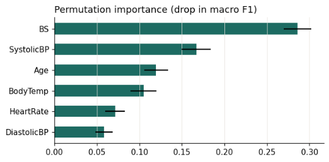
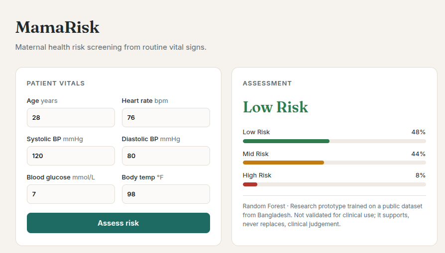

# 🤰 MamaRisk

**Maternal health risk screening from six routine vital signs, with an API and a clinician-facing dashboard.**

Most maternal deaths in low-resource settings trace back to conditions that announce themselves early: hypertension, gestational diabetes, infection. The measurements that catch them (blood pressure, blood glucose, temperature, heart rate) can be taken at a community clinic with basic equipment. MamaRisk asks how far those six numbers alone can go in flagging a high-risk pregnancy, and wraps the answer in a tool a health worker could actually use.

## What's inside

| Part | What it does |
|---|---|
| `notebooks/mamarisk_analysis.ipynb` | Exploration, model comparison, evaluation, feature importance, limitations |
| `mamarisk/` | Data cleaning and model code shared by the notebook, training script and API |
| `train.py` | Compares models with cross-validation and saves the best one |
| `api/main.py` | FastAPI service with input validation and interactive docs |
| `frontend/index.html` | React dashboard for entering vitals and reading the assessment |
| `tests/` | Tests for cleaning, modelling and the API, runnable without the dataset |

## Approach

- **Data:** [UCI Maternal Health Risk](https://doi.org/10.24432/C5DP5D), 1,014 records from hospitals and community clinics in rural Bangladesh, labelled low, mid or high risk.
- **Leakage check:** the raw file contains many exact duplicate rows. Left in, identical records fall on both sides of a train/test split and inflate scores. The notebook measures that inflation and reports only de-duplicated results.
- **Models:** logistic regression, random forest and gradient boosting, compared with 5-fold stratified cross-validation.
- **Metric that matters:** models are ranked by **high-risk recall** first. A missed high-risk pregnancy costs far more than an unnecessary referral.
- **Explainability:** permutation importance shows which vitals drive predictions.

## Results

**Data quality first.** Only **452 of 1,014 records are unique**; the rest are exact duplicates. Left in, duplicates leak between training and test folds and inflate scores, so all results below use the de-duplicated data. The data also contains physiologically impossible values (a minimum heart rate of 7 bpm), a reminder that public clinical datasets need checking before modelling.

**Model comparison** (5-fold stratified cross-validation, de-duplicated data)

| Model | Accuracy | Macro F1 | High-risk recall |
|---|---|---|---|
| **Random Forest** | 0.673 | 0.616 | **0.775** |
| Gradient Boosting | 0.681 | 0.615 | 0.687 |
| Logistic Regression | 0.588 | 0.547 | 0.678 |

Random Forest is the deployed model. Gradient Boosting edges it on accuracy, but Random Forest catches nearly 9 percentage points more high-risk pregnancies, which is the error that matters most.

**What drives predictions.** Blood glucose is the strongest predictor by a wide margin, followed by systolic blood pressure, consistent with gestational diabetes and hypertensive disorders as leading drivers of maternal risk.


## Run it

```bash
pip install -r requirements.txt
python train.py                  # downloads the dataset, compares models, saves the best
uvicorn api.main:app --reload    # dashboard at http://127.0.0.1:8000, API docs at /docs
pytest                           # run the tests
```

Or open the notebook in Google Colab and run all cells.

**Example request**

```bash
curl -X POST http://127.0.0.1:8000/predict -H "Content-Type: application/json" \
  -d '{"Age": 35, "SystolicBP": 140, "DiastolicBP": 90, "BS": 13.0, "BodyTemp": 98.0, "HeartRate": 70}'
```
   
## Limitations

- Trained on a small dataset from one region of Bangladesh; untested on Kenyan or other East African populations.
- Each record is a single snapshot, while real deterioration shows up as trends across visits.
- The original labelling criteria are not fully documented.
- **This is a research prototype, not a medical device.** It is meant to support clinical judgement, never to replace it.

## Next steps

- Validate against local facility data, with ethics approval
- Calibrate probabilities and set thresholds together with clinicians
- Add trend features from repeated antenatal visits
- Offline-first mobile front end for clinics with unreliable connectivity

## Credits

Dataset: Ahmed, M. & Kashem, M. A. (2023). *Maternal Health Risk.* UCI Machine Learning Repository, CC BY 4.0.


